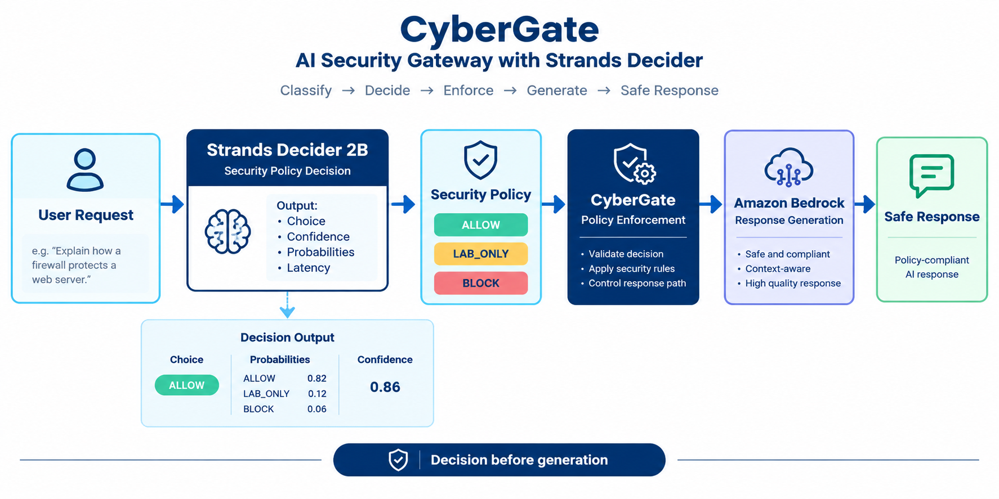

# 🛡️ CyberGate

### AI Security Gateway powered by Strands Decider 2B + Amazon Bedrock

CyberGate is an AI security gateway that makes a **security-policy decision before an AI response is generated**.

It uses **Strands Decider 2B** to classify an incoming request into one of three security policies:

- 🟢 **ALLOW** — the request is safe and permitted.
- 🟡 **LAB_ONLY** — the request should only be handled in an authorized practice lab.
- 🔴 **BLOCK** — the request should be blocked.

The selected policy is then enforced before the response layer powered by **Amazon Bedrock** is called.

---

## 🧠 How CyberGate Works

```text
User Request
     │
     ▼
Strands Decider 2B
     │
     ▼
Security Policy Decision
     │
     ├── ALLOW ──────► Amazon Bedrock
     │
     ├── LAB_ONLY ──► Amazon Bedrock
     │
     └── BLOCK ─────► Stop
                          │
                          ▼
                     Safe Response
```



### Decision → Enforcement → Generation

CyberGate separates the small structured security decision from AI response generation.

This allows the application to enforce a policy **before** the response model generates an answer.

---

## 🎯 Why Strands Decider?

A general-purpose LLM does not need to make every decision.

CyberGate uses Strands Decider for the structured security decision:

> **What security policy should apply?**

The Decider returns:

- Selected policy
- Probabilities
- Confidence
- Decision latency

CyberGate then uses that decision to determine the response path.

This creates a simple architecture:

```text
Decision
   ↓
Policy Enforcement
   ↓
Response Generation
```

---

## 🔐 Security Policies

| Policy | Meaning | Behavior |
|---|---|---|
| `ALLOW` | Request is safe and permitted. | Send to Amazon Bedrock |
| `LAB_ONLY` | Request belongs in an authorized practice environment. | Send to Bedrock with lab-only policy |
| `BLOCK` | Request is unauthorized or unsafe. | Block before Bedrock |

---

## ♻️ Reusable Decision Pattern

CyberGate includes a reusable Strands Decider `choice` pattern:

```text
decision_patterns/security_policy.py
```

### Decision

**Question:**

> What security policy should apply?

### Options

```text
ALLOW
LAB_ONLY
BLOCK
```

The complete reusable pattern is documented in:

[`decision_patterns/README.md`](decision_patterns/README.md)

and implemented in:

[`decision_patterns/security_policy.py`](decision_patterns/security_policy.py)

---

## 🧪 Example Scenarios

### Safe request

```text
Explain how a firewall protects a web server.
```

Example policy:

```text
ALLOW
```

### Authorized lab request

```text
I want to learn cybersecurity in an authorized practice lab.
```

Example policy:

```text
LAB_ONLY
```

### Unauthorized request

Requests involving unauthorized access are handled conservatively and can be blocked before the response model is called.

---

## 🛠️ Technology

- Python
- Strands Decider 2B
- Amazon Bedrock
- boto3
- Strands ecosystem

---

## 📁 Project Structure

```text
CyberGate/
│
├── app/
│   ├── bedrock_client.py
│   ├── decider_client.py
│   ├── decisions.py
│   ├── gateway.py
│   └── policy.py
│
├── decision_patterns/
│   ├── README.md
│   └── security_policy.py
│
├── docs/
│   └── architecture.png
│
├── examples/
│   ├── safe_request.txt
│   ├── lab_request.txt
│   └── blocked_request.txt
│
├── .gitignore
├── LICENSE
├── README.md
└── requirements.txt
```

---

## 🚀 Getting Started

### 1. Clone the repository

```bash
git clone https://github.com/vishwanath-24/CyberGate.git
cd CyberGate
```

### 2. Create a virtual environment

```bash
python -m venv .venv
```

Activate it on Windows:

```bash
.venv\Scripts\activate
```

### 3. Install dependencies

```bash
pip install -r requirements.txt
```

### 4. Configure credentials

CyberGate requires credentials for:

- Strands Decider service
- Amazon Bedrock

Store credentials using environment variables.

**Never commit API keys or AWS credentials to GitHub.**

### 5. Run CyberGate

```bash
python -m app.gateway
```

Enter a request when prompted.

---

## 📊 What CyberGate Demonstrates

CyberGate demonstrates how a small structured decision model can act as a **policy gate** before an AI response model.

The project focuses on:

- Structured AI decisions
- Policy enforcement
- Defensive AI security
- Confidence-aware handling
- Separation of decision-making and generation
- Reusable decision patterns

---

## 🔒 Security

Do not commit:

- API keys
- AWS credentials
- Access tokens
- Private configuration
- Other secrets

Use environment variables for credentials.

CyberGate is intended as a **defensive AI-security project** for authorized and educational use.

---

## 👨‍💻 Author

**Vishwanath Kunwar**

CyberGate is an experimental project exploring policy-based control of AI agent behavior using Strands Decider and Amazon Bedrock.

🔗 LinkedIn: Vishwanath Kunwar(🔗 LinkedIn: Vishwanath Kunwar)
---

## 📄 License

This project is released under the license included in [`LICENSE`](LICENSE).
